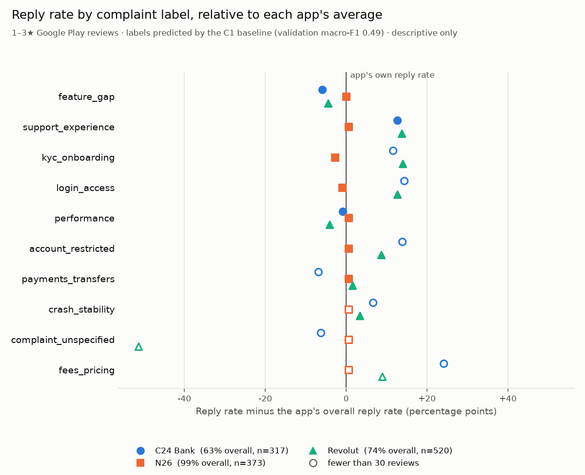

# support-reply-gap


Which complaint types in German fintech app reviews get a developer reply,
and how fast? This repo classifies Google Play reviews into complaint
categories and joins them to reply data. The result is a descriptive table:
reply rate and median reply latency per complaint type.

**Status:** Phase A (skeleton) is done. Phase B is nearly done: the three apps
are chosen (see [App selection](#app-selection-stage-b1)), their reviews are
ingested (see [Data](#data)), the label taxonomy is set (see
[Taxonomy](#taxonomy-stage-b4)) and 300 reviews are sampled, split and
hand-labelled (see [Gold set](#gold-set-stage-b5)). The self-agreement
measurement is still open. There are no models or findings yet. The full plan is in
[docs/build-order.md](docs/build-order.md).

## Approach

1. Scrape Google Play reviews for three German apps from one product category
   (neobanks *or* brokers, not a mix, because complaint base rates differ).
   The apps are chosen by measured reply rate, not picked up front.
2. Hand-label ~300 reviews into a multi-label complaint taxonomy. This gold
   set is the yardstick for every model.
3. Compare two classifiers against it: a cheap TF-IDF + logistic regression
   baseline and an LLM with structured output. A confidence router sends
   uncertain reviews from the baseline to the LLM.
4. Join the predicted labels to reply data and report reply rate and latency
   per complaint type.

Findings will be descriptive only. Companies choose which reviews to answer
and that choice is not observed, so the data cannot show *why* a complaint
type gets more or fewer replies.

## App selection (stage B1)

Probed on 2026-11-03 with [scripts/probe_apps.py](scripts/probe_apps.py):
the newest 2,000 reviews per app from the German Play Store. Reply rates leave
out reviews younger than 14 days, which may not have been answered yet.

| App | Reviews/day | Reply rate | Reply rate, 1–2★ | Median reply time | German reviews\* |
|---|---:|---:|---:|---:|---:|
| N26 | 4.6 | 97.9% | 99.7% | 16.5 h | 68% |
| Revolut | 17.4 | 12.5% | 72.3% | 0.4 h | 43% |
| C24 Bank | 3.3 | 14.9% | 41.9% | 75.4 h | 70% |
| bunq | 1.4 | 99.7% | 99.9% | 58.6 h | 62% |
| Vivid Money | 1.1 | 32.6% | 48.2% | 59.8 h | 73% |

\* Rough heuristic: share of reviews with at least two common German words or
umlauts.

Neobanks were chosen over brokers because broker review volume is concentrated
in Trade Republic, which replies to 2.4% of its 1–2 star reviews. Food delivery
was rejected because only one of six apps (Lieferando) replies to most of its
reviews. bunq and Vivid Money were excluded because they get fewer than 1.5
reviews per day. That leaves **N26, Revolut and C24 Bank**.

**To revisit:** Revolut's median reply time is 0.4 hours, against 16–75 hours
for the other neobanks, while it replies to only 12.5% of reviews overall. Which
complaint types make up that fast-answered subset is a question for the
reply-gap analysis, not a finding yet.

## Data

Collected on 2026-11-03 with `python -m support_reply_gap.ingest`: every
review posted in the previous two years (2024-11-03 to 2026-11-02), 21,197 in
total.

| Quarter | C24 reviews | C24 replied | N26 reviews | N26 replied | Revolut reviews | Revolut replied |
|---|---:|---:|---:|---:|---:|---:|
| 2024Q4\* | 386 | 1.6% | 346 | 35.3% | 1,374 | 9.7% |
| 2025Q1 | 754 | 2.5% | 319 | 33.5% | 2,166 | 8.1% |
| 2025Q2 | 353 | 2.3% | 342 | 80.1% | 2,106 | 7.4% |
| 2025Q3 | 293 | 1.4% | 449 | 93.1% | 2,060 | 13.1% |
| 2025Q4 | 274 | 2.6% | 639 | 100.0% | 1,529 | 14.2% |
| 2026Q1 | 230 | 14.8% | 359 | 100.0% | 2,228 | 7.8% |
| **2026Q2** | 251 | 29.5% | 360 | 93.1% | 1,404 | 11.5% |
| **2026Q3** | 222 | 49.1% | 355 | 96.3% | 1,599 | 12.3% |
| **2026Q4**\* | 118 | 39.0% | 120 | 95.0% | 561 | 13.9% |

\* Partial quarter. The newest reviews in 2026Q4 may not have been answered
yet, so its reply rates are likely understated.

**Analysis window: 2026-04-01 onward (bold rows).** Two of the three apps
started replying regularly during the collection period: N26 in 2025Q2 and C24
in 2026Q1. Before those points, a missing reply reflects the absence of a reply
programme rather than anything about the review. Starting the window in 2026Q2
means all three apps are actively replying throughout. That leaves 591 C24, 835
N26 and 3,564 Revolut reviews. C24's reply rate still varies within the window
(29.5% to 49.1%), so time is part of what any C24 figure reflects.

**Edited reviews.** 512 reviews (2.4% of all reviews, 11.2% of replied ones)
have a reply timestamped earlier than the review itself. The user edited the
review after the reply, and Google keeps only the edit time, so the original
post time is lost. These reviews count toward reply rate but are excluded from
latency.

**Text reviews only.** The Play Store review endpoint returns only reviews with
text (none of the 21,197 are empty). Counts here are therefore not comparable
to an app's total rating count on the store, which includes star-only ratings.

**Observed, not analysed: reply programmes switching on.** The quarterly table
contains a sharper question than the static comparison: *when an app starts
replying, which complaint types are answered first?* C24's reply rate rises
from 2.6% to 49.1% across four quarters, with the same app and the same
complaint taxonomy before and after. This is outside the current scope and stays
descriptive, like everything else here. It is the fallback if the main
finding (stage C2) comes out thin.

## Taxonomy (stage B4)

Eleven labels, defined with real examples in [docs/taxonomy.md](docs/taxonomy.md).
That file is generated from
[taxonomy.py](src/support_reply_gap/labeling/taxonomy.py), so the definitions
and the code cannot drift apart.

The taxonomy is **multi-label**: a review can carry several labels, because
reviews often complain about two things at once. `no_complaint` and
`complaint_unspecified` are exclusive and never combined with another label.

I read a 150-review development sample against eight draft labels. That took
the set to eleven: `account_restricted`, `performance` and
`complaint_unspecified` were added, and `fees_pricing` was widened to money
the user believes they are owed (rewards, bonuses, referral payouts).
Trading/crypto and in-app advertising were considered as labels and rejected.
Both were too rare, and trading only came up for Revolut. Ads fold into
`feature_gap`; trading complaints into `payments_transfers` (orders not
executed) or `feature_gap` (missing or changed trading features). The 150 development reviews are excluded
from the gold set.

## Gold set (stage B5)

300 reviews, hand-labelled by me, are the yardstick for every model. Only
review IDs and labels are committed ([data/gold/](data/gold/)). Review text
stays in a local, gitignored sheet.

**Sampling.** The sample is drawn from the analysis window after the B3
cleaning rules: German or uncertain language, no one-word or emoji-only
reviews, repeated text dropped, at most two reviews per app, day and star
rating. It is weighted toward complaints and spread evenly across the three
apps. A random sample would mostly contain 5★ praise and few examples of the
rarer complaint types.

400 reviews were drawn, then trimmed to 300 before labelling to keep
hand-labelling time manageable. The trim drops reviews at random within each
split × app × star-rating cell, so the balance survives: 1★ 128, 2★ 68,
3★ 60, 4★ 23, 5★ 21, and 101 C24, 99 N26, 100 Revolut. The cost is that more
labels fall under 20 examples; they are flagged, not merged.

**Split.** 60/20/20 train/validation/test (180 / 60 / 60 reviews), using
iterative stratification so that every label appears in each split. The split
was drawn on the 400 using labels from an earlier labelling pass, so it is
stratified on those labels, and the trim removed reviews from each split in proportion.
It is not redrawn: no model has seen the test set, and dropping test reviews
leaks nothing about the ones that remain.

**Label counts.** From the hand-labelled pass. 227 reviews carry one label,
73 carry two or more.

| Label | Total | Train | Val | Test |
|---|---:|---:|---:|---:|
| `feature_gap` | 114 | 69 | 23 | 22 |
| `support_experience` | 48 | 30 | 7 | 11 |
| `performance` | 40 | 17 | 11 | 12 |
| `kyc_onboarding` | 37 | 23 | 9 | 5 |
| `login_access` | 34 | 21 | 6 | 7 |
| `payments_transfers` | 28 | 16 | 5 | 7 |
| `no_complaint` | 25 | 14 | 5 | 6 |
| `crash_stability` | 21 | 11 | 6 | 4 |
| `account_restricted` | 21 | 12 | 5 | 4 |
| `complaint_unspecified` | 12 | 10 | 1 | 1 |
| `fees_pricing` | 10 | 7 | 2 | 1 |

`complaint_unspecified` and `fees_pricing` fall under 20 examples and are
too small to judge. With one test review each, their test-set F1 is close
to meaningless, so they are flagged in the eval rather than merged. The split
was stratified on the earlier pass's labels, not these. Redrawing it now would mean
choosing the test set after seeing its labels, so it stays.

**Self-agreement.** 50 of the 300, picked at random, were labelled a second
time, blind and days after the first pass
([reports/self_agreement.md](reports/self_agreement.md)). Scored against the
first pass with the same macro-F1 used for the models, agreement is **0.69
macro-F1**, and 64% of reviews get exactly the same label set. That is the
realistic ceiling for any model. Agreement is lowest for `performance` (F1
0.25) and `crash_stability` (0.50): the line between slow and broken is the
least stable boundary in the taxonomy. `fees_pricing` does not occur among the
50, so the macro average covers ten labels, and five of those have fewer than
5 examples.

## Baseline (stage C1)

TF-IDF over words and character n-grams (3–5 characters within word
boundaries, so parts of German compounds share features), with one logistic
regression per label and balanced class weights. Trained on the 180 train
reviews and tuned on the 60 validation reviews. The test set stays untouched
until the eval harness (C3).

80 settings were tried: regularisation strength C, German stopwords on/off,
word pairs on/off, and the decision threshold. Chosen: C = 10, no stopwords,
single words, threshold 0.3.

| | Macro-F1 |
|---|---:|
| Baseline, validation (60 reviews) | 0.486 |
| Human self-agreement (50 reviews) | 0.69 |

- The baseline reaches about 70% of the human ceiling (0.486 vs. 0.69).
- The two labels the baseline handles worst, `performance` and
  `crash_stability`, are also the two where my own labels agree least. Part of
  its weakness there is a fuzzy boundary, not only a weak model.
- Neither German stopwords nor word pairs helped. The character n-grams
  probably already cover what they would add.
- `performance` (F1 0.15) and `crash_stability` (0.25) are rarely predicted:
  2 predictions each against 11 and 6 true cases.
- `fees_pricing` and `complaint_unspecified` have 2 and 1 validation reviews.
  Their F1 is not interpretable.
- 0.486 is the best of 80 settings on the same 60 reviews, so it is
  optimistic. The comparable number is the test-set score from C3.
- The ceiling and the baseline are measured on different reviews (a random
  50 from all splits vs. the 60 validation reviews). The comparison is
  indicative, not exact.

## First answer (stage C2)

A rough first pass at the finding: the C1 baseline labels every 1–3★ review in
the analysis window (1,210 reviews), and each label is joined to whether and how
fast the app replied. Tables, chart and caveats are in
[reports/reply_gap_c2.md](reports/reply_gap_c2.md). Only cells with at least 30
reviews are read here.



At C24 and Revolut, reviews labelled `support_experience` receive a reply 13–14
points more often than the app's 1–3★ reviews overall (76% vs. 63%, 88% vs.
74%), and at Revolut the same holds for `kyc_onboarding`, `login_access` and
`account_restricted` (9–14 points), while `feature_gap` and `performance` sit
1–5 points below the app's rate. Part of this lines up with star rating: 1★
reviews receive a reply more often than 2★ and 3★ (84% vs. 70% and 69%), and the
labels above the line mostly carry a higher share of 1★ reviews, although
`login_access` at Revolut does not (78% vs. 80% for the app). N26 replies to
99% of these reviews, so its reply rate does not separate labels, and reply
latency differs far more between apps (median about 3 days at C24, 4 hours at
N26, 23 minutes at Revolut) than between labels within an app.

4–5★ reviews are left out because the baseline puts complaint labels on about
half of all 5★ reviews, which is implausible. The labels come from a model at
0.49 validation macro-F1, so these numbers are a starting point, not the
result.

## Evaluation (stage C3)

Every model is scored by one harness against the frozen gold set, and the
results land in [reports/eval.md](reports/eval.md). The harness was built
before the LLM path, so the LLM is measured by a yardstick that existed before
it did.

- **Interface.** A model provides one call: one review in, labels and the cost
  of the call out. Reviews are classified one at a time, as the API and the
  router will call it, so the latency is per review.
- **Measures.** Macro-F1 with a 95% interval (from resampling the split's
  reviews 1,000 times), per-class F1 with support, exact match, cost per 1,000
  reviews, p95 latency, and a label × label confusion matrix.
- **Validation and test.** Both are scored. Validation drives decisions
  (thresholds, prompts). Test is reported and never used to choose anything,
  and its confusion matrix stays out of the table so its errors do not steer
  changes.
- **Versioning.** Each run writes a result file to
  [reports/eval/](reports/eval/) with the commit and a checksum of the gold
  labels and split, so results measured against a different gold set are
  flagged instead of compared.

| | Val macro-F1 (95% CI) | Test macro-F1 (95% CI) | Cost / 1k | p95 latency |
|---|---:|---:|---:|---:|
| Human self-agreement | 0.69 | | | |
| Baseline (C1) | 0.49 (0.34–0.63) | 0.45 (0.34–0.59) | $0.00 | 14 ms |

The intervals are wide: with 60 reviews per split, a second model has to beat
the baseline by a clear margin before the table can tell them apart. On
validation, 7 of the 11 true `performance` reviews are predicted as
`feature_gap`, so the baseline mostly confuses "slow" with "missing", not with
"broken".

## What works now

- **Package:** `support_reply_gap` installs with `pip install -e`.
- **Database:** Postgres 16 in Docker Compose, on host port 5433.
- **CI:** GitHub Actions runs `ruff` and `pytest` on every pull request and
  push to `main`. Tests that need a live database are skipped there.
- **API:** a FastAPI app with one `/health` endpoint, containerised and
  deployed on Render at
  [support-reply-gap.onrender.com/health](https://support-reply-gap.onrender.com/health).
  It is a stub; the real `/classify` endpoint replaces it in Phase D.

## Running it locally

Needs Python 3.11+ and Docker.

```bash
# Install the package and dev tools into a virtual environment
python -m venv .venv
source .venv/bin/activate
pip install -e ".[dev]"
python -m nltk.downloader stopwords

# Start Postgres (fill in .env first)
cp .env.example .env
docker compose up -d

# Run all tests, including the database ones
pytest

# Score the baseline and rebuild reports/eval.md (needs the database)
python -m support_reply_gap.eval --model baseline

# Run the API on http://localhost:8000/health
docker build -t support-reply-gap .
docker run -p 8000:8000 support-reply-gap
```

## Repo layout

```
src/support_reply_gap/   the package: ingest/, labeling/, eval/, analysis/, api/
data/gold/               hand-labelled gold set: IDs, labels, split (committed)
tests/                   pytest; database tests marked @pytest.mark.db
notebooks/               exploration only, never imported by src/
scripts/                 standalone utilities
reports/                 generated tables
docs/build-order.md      stage-by-stage plan with a definition of done each
docs/taxonomy.md         label definitions with examples, generated
```
