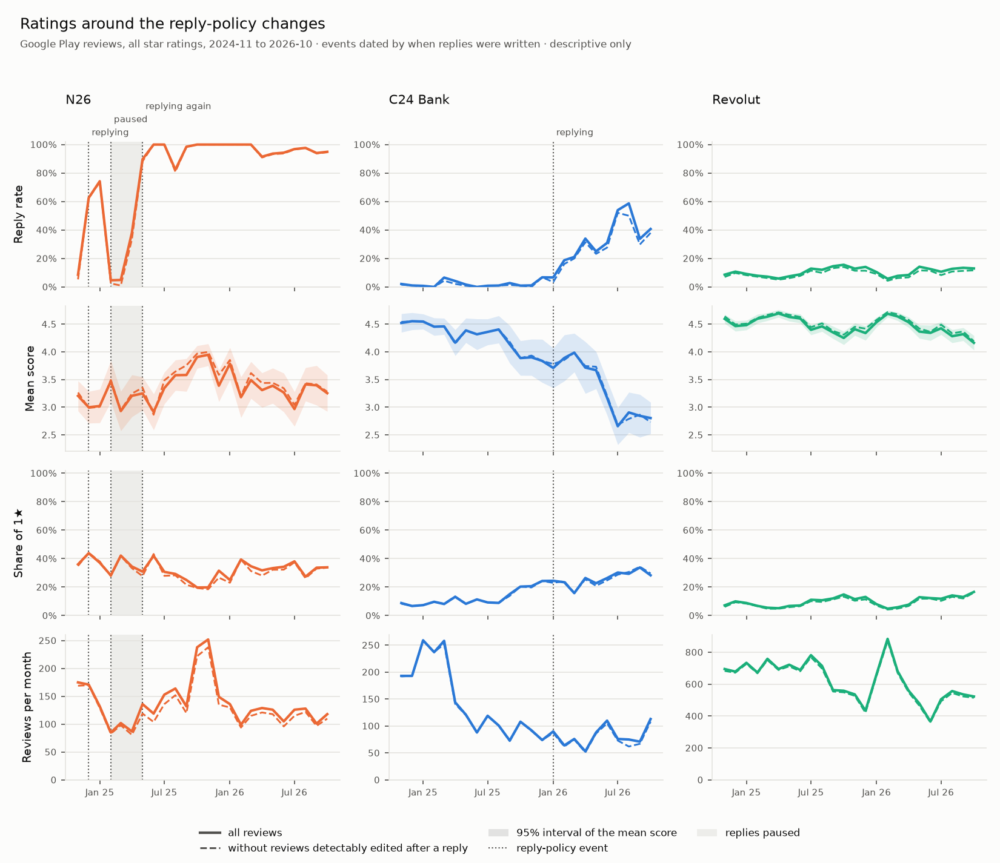

# Ratings around the reply-policy changes (stage D1b)

Generated by `python -m support_reply_gap.analysis.policy_change_report`. Do not edit
by hand.

Descriptive only. The companies chose when to start or stop replying, and other things
changed at the same time: app releases, pricing, the user base, the news. Nothing here
says what replying does to ratings. Revolut is a reference series,
not a control.

**Population.** 21,152 Google Play reviews of all star ratings, dated
2024-11 to 2026-10 by the month of `posted_at`. 2026-11 is left out because
the scrape ended on the 3rd.

**Events**, dated by the month replies were written and fixed in `docs/build-order.md`
before any rating series was drawn:

- N26: replying from 2024-12, paused from 2025-02, replying again from 2025-05.
- C24 Bank: replying from 2026-01.
- Revolut: no change; a reference series, not a control.

**Edited reviews.** Google Play keeps only a review's latest version, so a review edited
after a reply carries the edit's date and score. 510 reviews are detectably edited
(a reply timestamped before the review). Edits are detectable only when a reply exists,
so more replies mean more detectable edits; the edited share is not an outcome. Every
figure below is given with and without the detectable ones. Undetectable edits remain
in both.

## Per period: all reviews

| App | Span | Months | Reviews | Mean score (95% CI) | 1★ | Replied | Revolut: mean score | Revolut: 1★ |
|---|---|---|---:|---:|---:|---:|---:|---:|
| N26 | before | 2024-11 to 2024-11 | 175 | 3.21 (2.93–3.48) | 36% | 9% | 4.60 (4.52–4.68) | 7% |
| N26 | replying | 2024-12 to 2025-01 | 303 | 3.01 (2.80–3.22) | 41% | 68% | 4.48 (4.41–4.54) | 9% |
| N26 | paused | 2025-02 to 2025-04 | 274 | 3.19 (2.97–3.40) | 35% | 15% | 4.64 (4.60–4.69) | 6% |
| N26 | replying again | 2025-05 to 2026-10 | 2,535 | 3.47 (3.40–3.54) | 30% | 96% | 4.45 (4.43–4.48) | 10% |
| C24 Bank | before | 2024-11 to 2025-12 | 2,060 | 4.36 (4.30–4.41) | 11% | 2% | 4.51 (4.48–4.53) | 9% |
| C24 Bank | replying | 2026-01 to 2026-10 | 816 | 3.30 (3.19–3.42) | 26% | 32% | 4.46 (4.43–4.49) | 10% |

## Per period: without edited reviews

| App | Span | Months | Reviews | Mean score (95% CI) | 1★ | Replied | Revolut: mean score | Revolut: 1★ |
|---|---|---|---:|---:|---:|---:|---:|---:|
| N26 | before | 2024-11 to 2024-11 | 169 | 3.27 (2.99–3.54) | 35% | 5% | 4.64 (4.57–4.72) | 6% |
| N26 | replying | 2024-12 to 2025-01 | 299 | 3.00 (2.79–3.21) | 41% | 67% | 4.50 (4.44–4.57) | 9% |
| N26 | paused | 2025-02 to 2025-04 | 262 | 3.21 (2.99–3.43) | 35% | 11% | 4.67 (4.63–4.71) | 5% |
| N26 | replying again | 2025-05 to 2026-10 | 2,344 | 3.55 (3.48–3.62) | 28% | 96% | 4.50 (4.47–4.52) | 9% |
| C24 Bank | before | 2024-11 to 2025-12 | 2,046 | 4.36 (4.30–4.42) | 11% | 1% | 4.54 (4.52–4.57) | 8% |
| C24 Bank | replying | 2026-01 to 2026-10 | 776 | 3.31 (3.20–3.43) | 26% | 29% | 4.50 (4.47–4.53) | 9% |

## Per month: all reviews

| Month | N26 n | N26 mean | N26 1★ | N26 replied | C24 Bank n | C24 Bank mean | C24 Bank 1★ | C24 Bank replied | Revolut n | Revolut mean | Revolut 1★ | Revolut replied |
|---|---:|---:|---:|---:|---:|---:|---:|---:|---:|---:|---:|---:|
| 2024-11 | 175 | 3.21 | 36% | 9% | 193 | 4.52 | 9% | 2% | 695 | 4.60 | 7% | 9% |
| 2024-12 | 171 | 3.00 | 44% | 63% | 193 | 4.55 | 7% | 1% | 679 | 4.47 | 10% | 11% |
| 2025-01 | 132 | 3.02 | 37% | 74% | 259 | 4.55 | 7% | 1% | 734 | 4.48 | 9% | 9% |
| 2025-02 | 85 | 3.47 | 28% | 5% | 237 | 4.46 | 10% | 0% | 673 | 4.60 | 7% | 8% |
| 2025-03 | 102 | 2.93 | 42% | 5% | 258 | 4.46 | 8% | 7% | 759 | 4.64 | 6% | 7% |
| 2025-04 | 87 | 3.21 | 34% | 38% | 144 | 4.17 | 13% | 4% | 695 | 4.69 | 5% | 6% |
| 2025-05 | 136 | 3.25 | 31% | 90% | 121 | 4.39 | 8% | 2% | 722 | 4.63 | 7% | 7% |
| 2025-06 | 119 | 2.92 | 42% | 100% | 88 | 4.32 | 11% | 0% | 689 | 4.60 | 7% | 9% |
| 2025-07 | 153 | 3.35 | 31% | 100% | 119 | 4.36 | 9% | 1% | 782 | 4.40 | 11% | 13% |
| 2025-08 | 164 | 3.58 | 29% | 82% | 101 | 4.41 | 9% | 1% | 715 | 4.46 | 11% | 12% |
| 2025-09 | 132 | 3.58 | 25% | 98% | 73 | 4.14 | 15% | 3% | 563 | 4.35 | 12% | 15% |
| 2025-10 | 238 | 3.91 | 20% | 100% | 108 | 3.89 | 20% | 1% | 559 | 4.25 | 15% | 16% |
| 2025-11 | 252 | 3.95 | 20% | 100% | 92 | 3.90 | 21% | 1% | 536 | 4.41 | 12% | 13% |
| 2025-12 | 149 | 3.39 | 32% | 100% | 74 | 3.84 | 24% | 7% | 434 | 4.34 | 13% | 14% |
| 2026-01 | 136 | 3.79 | 25% | 100% | 90 | 3.71 | 24% | 7% | 662 | 4.54 | 8% | 10% |
| 2026-02 | 99 | 3.18 | 39% | 100% | 64 | 3.89 | 23% | 19% | 884 | 4.69 | 5% | 6% |
| 2026-03 | 124 | 3.49 | 35% | 100% | 76 | 3.99 | 16% | 21% | 682 | 4.64 | 6% | 8% |
| 2026-04 | 129 | 3.31 | 32% | 91% | 53 | 3.72 | 26% | 34% | 559 | 4.54 | 8% | 8% |
| 2026-05 | 126 | 3.39 | 33% | 94% | 88 | 3.67 | 23% | 25% | 479 | 4.37 | 13% | 14% |
| 2026-06 | 105 | 3.27 | 34% | 94% | 110 | 3.17 | 26% | 31% | 366 | 4.34 | 12% | 13% |
| 2026-07 | 126 | 2.97 | 38% | 97% | 76 | 2.66 | 30% | 54% | 506 | 4.43 | 12% | 11% |
| 2026-08 | 128 | 3.41 | 27% | 98% | 75 | 2.91 | 29% | 59% | 557 | 4.28 | 14% | 13% |
| 2026-09 | 101 | 3.40 | 34% | 94% | 71 | 2.85 | 34% | 34% | 536 | 4.32 | 13% | 13% |
| 2026-10 | 118 | 3.25 | 34% | 95% | 113 | 2.81 | 28% | 41% | 523 | 4.16 | 17% | 13% |

## Per month: without edited reviews

| Month | N26 n | N26 mean | N26 1★ | N26 replied | C24 Bank n | C24 Bank mean | C24 Bank 1★ | C24 Bank replied | Revolut n | Revolut mean | Revolut 1★ | Revolut replied |
|---|---:|---:|---:|---:|---:|---:|---:|---:|---:|---:|---:|---:|
| 2024-11 | 169 | 3.27 | 35% | 5% | 192 | 4.54 | 8% | 2% | 683 | 4.64 | 6% | 7% |
| 2024-12 | 170 | 2.99 | 44% | 62% | 193 | 4.55 | 7% | 1% | 672 | 4.50 | 9% | 10% |
| 2025-01 | 129 | 3.01 | 38% | 74% | 258 | 4.55 | 7% | 0% | 727 | 4.51 | 8% | 8% |
| 2025-02 | 83 | 3.49 | 28% | 2% | 237 | 4.46 | 10% | 0% | 668 | 4.62 | 7% | 7% |
| 2025-03 | 98 | 2.95 | 42% | 1% | 252 | 4.46 | 8% | 4% | 751 | 4.67 | 5% | 6% |
| 2025-04 | 81 | 3.25 | 33% | 33% | 141 | 4.15 | 13% | 2% | 689 | 4.71 | 5% | 5% |
| 2025-05 | 119 | 3.35 | 28% | 88% | 120 | 4.38 | 8% | 1% | 712 | 4.67 | 6% | 6% |
| 2025-06 | 104 | 2.87 | 43% | 100% | 88 | 4.32 | 11% | 0% | 681 | 4.63 | 7% | 8% |
| 2025-07 | 136 | 3.49 | 28% | 100% | 119 | 4.36 | 9% | 1% | 769 | 4.45 | 10% | 11% |
| 2025-08 | 152 | 3.64 | 28% | 81% | 101 | 4.41 | 9% | 1% | 698 | 4.52 | 10% | 10% |
| 2025-09 | 120 | 3.76 | 22% | 98% | 72 | 4.18 | 14% | 1% | 554 | 4.38 | 11% | 13% |
| 2025-10 | 222 | 3.97 | 19% | 100% | 108 | 3.89 | 20% | 1% | 549 | 4.31 | 13% | 14% |
| 2025-11 | 238 | 4.00 | 18% | 100% | 91 | 3.93 | 20% | 0% | 527 | 4.45 | 10% | 11% |
| 2025-12 | 135 | 3.59 | 27% | 100% | 74 | 3.84 | 24% | 7% | 421 | 4.42 | 11% | 11% |
| 2026-01 | 130 | 3.85 | 23% | 100% | 87 | 3.78 | 23% | 3% | 652 | 4.58 | 7% | 9% |
| 2026-02 | 94 | 3.20 | 39% | 100% | 62 | 3.85 | 24% | 16% | 871 | 4.72 | 4% | 4% |
| 2026-03 | 115 | 3.62 | 31% | 100% | 75 | 3.99 | 16% | 20% | 671 | 4.68 | 5% | 6% |
| 2026-04 | 121 | 3.44 | 28% | 91% | 51 | 3.75 | 25% | 31% | 549 | 4.58 | 7% | 7% |
| 2026-05 | 118 | 3.44 | 32% | 93% | 86 | 3.73 | 21% | 23% | 465 | 4.42 | 12% | 12% |
| 2026-06 | 96 | 3.34 | 32% | 94% | 105 | 3.21 | 25% | 28% | 361 | 4.36 | 12% | 11% |
| 2026-07 | 115 | 3.04 | 37% | 97% | 73 | 2.68 | 29% | 52% | 493 | 4.49 | 10% | 8% |
| 2026-08 | 122 | 3.43 | 26% | 98% | 62 | 2.79 | 31% | 50% | 545 | 4.34 | 13% | 11% |
| 2026-09 | 97 | 3.41 | 33% | 94% | 67 | 2.87 | 34% | 30% | 523 | 4.37 | 12% | 11% |
| 2026-10 | 110 | 3.28 | 34% | 95% | 108 | 2.73 | 30% | 38% | 515 | 4.19 | 16% | 12% |

## Caveats

- The 95% interval of a mean score covers sampling noise among the reviews written,
  not who chooses to write one. Review writers are not a sample of users.
- N26's span before its first event is one month. Its "paused" span follows a
  two-month burst of replies, so it is not a clean "never replied" baseline either.
- C24's replies rose gradually from 2026-01; its "replying" span mixes months with
  low and high reply rates.
- Text reviews only: star-only ratings are not returned by the review endpoint.
