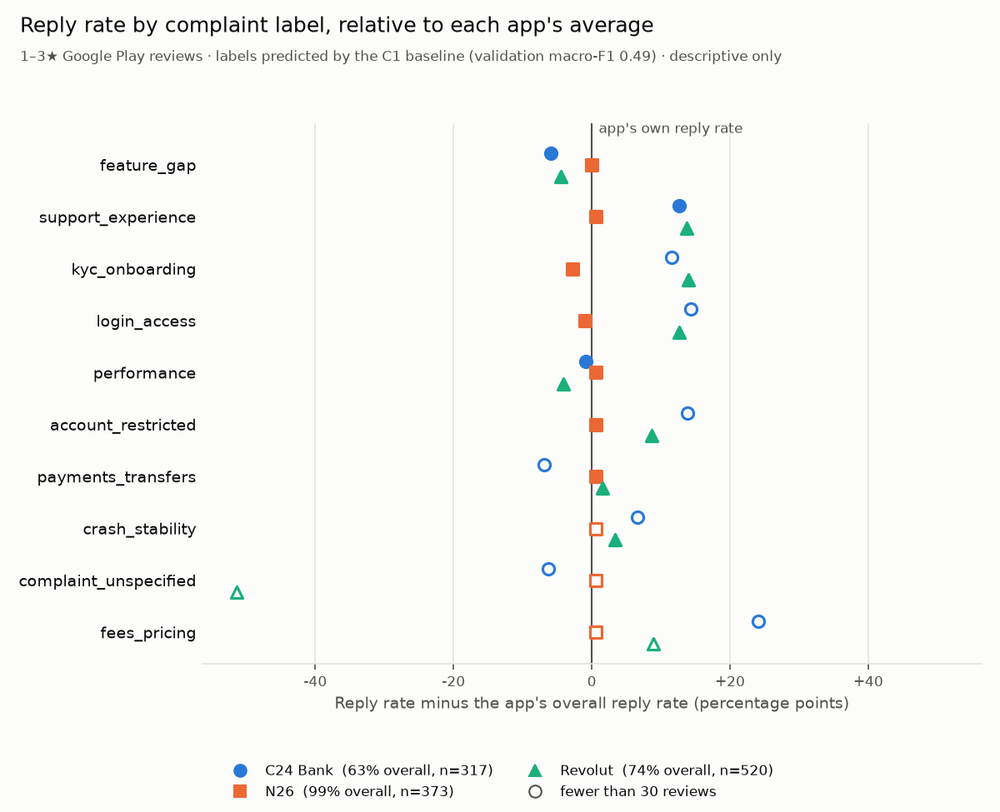

# Reply gap: first end-to-end answer (stage C2)

Generated by `python -m support_reply_gap.analysis.c2_report`. Do not edit by hand.

Descriptive only. Which reviews receive a reply is each company's choice, and that
choice is unobserved. Nothing here says why a complaint type is or is not answered.

**Population.** 1,210 Google Play reviews rated 1–3★, posted
2026-04-01 to 2026-11-02, after the B3 cleaning rules (German or uncertain language, not a
single word), repeated texts kept.

**Labels.** Predicted by the C1 baseline (TF-IDF + logistic regression, C = 10,
threshold 0.3), validation macro-F1 0.486. Trained on the
240 train and validation reviews of the gold set; 204 of those fall in this
population. A review with several labels counts once in each.

## Reply rate

Share of reviews with a reply, with the number of reviews in brackets. *Italic*: fewer
than 30 reviews, not to be interpreted.

| Label | C24 Bank | N26 | Revolut | All apps |
|---|---:|---:|---:|---:|
| (all reviews) | 63% (317) | 99% (373) | 74% (520) | 79% (1210) |
| `feature_gap` | 58% (219) | 99% (187) | 70% (203) | 75% (609) |
| `support_experience` | 76% (50) | 100% (98) | 88% (161) | 90% (309) |
| `kyc_onboarding` | *75% (12)* | 97% (60) | 88% (129) | 90% (201) |
| `login_access` | *78% (27)* | 99% (67) | 87% (85) | 90% (179) |
| `performance` | 62% (56) | 100% (32) | 70% (37) | 74% (125) |
| `account_restricted` | *77% (22)* | 100% (31) | 83% (65) | 86% (118) |
| `payments_transfers` | *57% (23)* | 100% (34) | 76% (50) | 79% (107) |
| `crash_stability` | *70% (10)* | *100% (25)* | 78% (36) | 85% (71) |
| `complaint_unspecified` | *57% (7)* | *100% (10)* | *23% (13)* | 57% (30) |
| `fees_pricing` | *88% (8)* | *100% (8)* | *83% (6)* | *91% (22)* |
| `no_complaint` | *100% (2)* | *100% (4)* | *0% (10)* | *38% (16)* |

## Median reply latency

Among replied reviews whose latency is known (edited reviews have none), count in
brackets. *Italic*: fewer than 30.

| Label | C24 Bank | N26 | Revolut | All apps |
|---|---:|---:|---:|---:|
| (all reviews) | 3.1 d (184) | 3.8 h (339) | 23 min (337) | 1.8 h (860) |
| `feature_gap` | 3.4 d (114) | 2.9 h (165) | 25 min (115) | 4.7 h (394) |
| `support_experience` | 2.9 d (34) | 4.6 h (85) | 22 min (113) | 1.1 h (232) |
| `kyc_onboarding` | *2.4 d (9)* | 7.0 h (54) | 22 min (105) | 31 min (168) |
| `login_access` | *47.1 h (18)* | 4.4 h (59) | 21 min (59) | 1.4 h (136) |
| `performance` | 3.6 d (33) | 7.8 h (30) | *27 min (22)* | 12.5 h (85) |
| `account_restricted` | *3.1 d (16)* | *6.4 h (27)* | 21 min (48) | 38 min (91) |
| `payments_transfers` | *2.5 d (12)* | 2.8 h (32) | 25 min (33) | 1.1 h (77) |
| `crash_stability` | *46.0 h (6)* | *1.3 h (25)* | *30 min (24)* | 50 min (55) |
| `complaint_unspecified` | *43.9 h (4)* | *1.1 h (10)* | *29 min (3)* | *1.1 h (17)* |
| `fees_pricing` | *2.1 d (7)* | *9.9 h (7)* | *27 min (4)* | *13.6 h (18)* |
| `no_complaint` | *6.2 d (2)* | *6.4 h (4)* | – | *26.9 h (6)* |

## Share of 1★ reviews

In this population 1★ reviews receive a reply more often (84%) than 2★
(70%) and 3★ (69%). A label with a high share of 1★ reviews can
show a higher reply rate for that reason alone.

| Label | C24 Bank | N26 | Revolut | All apps |
|---|---:|---:|---:|---:|
| (all reviews) | 51% | 71% | 80% | 70% |
| `feature_gap` | 43% | 65% | 74% | 60% |
| `support_experience` | 76% | 87% | 89% | 86% |
| `kyc_onboarding` | 83% | 85% | 87% | 86% |
| `login_access` | 59% | 72% | 78% | 73% |
| `performance` | 52% | 53% | 68% | 57% |
| `account_restricted` | 86% | 90% | 95% | 92% |
| `payments_transfers` | 61% | 74% | 86% | 77% |
| `crash_stability` | 70% | 76% | 72% | 73% |
| `complaint_unspecified` | 43% | 30% | 77% | 53% |
| `fees_pricing` | 62% | 62% | 50% | 59% |
| `no_complaint` | 50% | 100% | 40% | 56% |

## Check: reply rate without the training reviews

The same reply rates without the 204 reviews the model was trained on, whose
labels mostly repeat the human ones. Close agreement with the first table means
those reviews do not drive the pattern.

| Label | C24 Bank | N26 | Revolut | All apps |
|---|---:|---:|---:|---:|
| (all reviews) | 62% (250) | 100% (308) | 75% (448) | 79% (1006) |
| `feature_gap` | 57% (182) | 99% (159) | 72% (186) | 75% (527) |
| `support_experience` | 76% (42) | 100% (84) | 89% (148) | 91% (274) |
| `kyc_onboarding` | *67% (9)* | 98% (50) | 87% (110) | 89% (169) |
| `login_access` | *79% (19)* | 100% (56) | 87% (78) | 91% (153) |
| `performance` | 64% (42) | *100% (28)* | *62% (29)* | 74% (99) |
| `account_restricted` | *76% (17)* | *100% (25)* | 83% (59) | 86% (101) |
| `payments_transfers` | *53% (17)* | 100% (31) | 73% (41) | 79% (89) |
| `crash_stability` | *50% (6)* | *100% (20)* | *79% (28)* | 83% (54) |
| `complaint_unspecified` | *67% (6)* | *100% (7)* | *14% (7)* | *60% (20)* |
| `fees_pricing` | *75% (4)* | *100% (6)* | *75% (4)* | *86% (14)* |
| `no_complaint` | *100% (2)* | *100% (4)* | *0% (9)* | *40% (15)* |

## Caveats

- The labels are model predictions at validation macro-F1 0.49, not
  human labels. `performance` and `crash_stability` were under-predicted on
  validation, so their counts here are likely too low.
- 4–5★ reviews are left out: on them the baseline assigns complaint labels to about
  half of all 5★ reviews, which looks implausible. The gold set holds 21 5★ reviews.
- App and star rating vary the reply rate more than the label does. Label differences
  are compared within an app; the "All apps" column mixes apps and is shown for
  completeness only.
- N26 replies to nearly every 1–3★ review, so its reply rates cannot separate labels.
