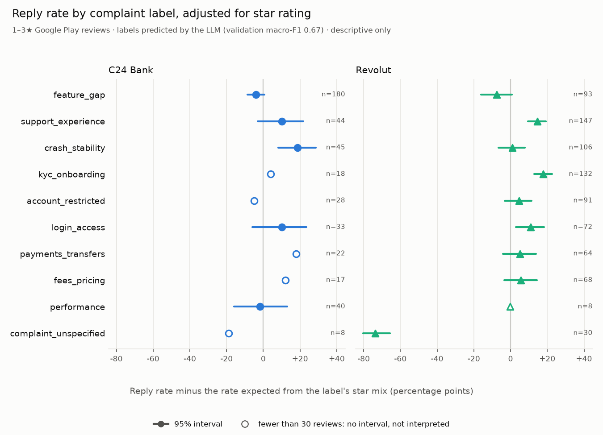

# Reply gap: final analysis (stage D1)

Generated by `python -m support_reply_gap.analysis.d1_report`. Do not edit by hand.

Descriptive only. Which reviews receive a reply is each company's choice, and that
choice is unobserved. Nothing here says why a complaint type is or is not answered.

**Population.** 1,210 Google Play reviews rated 1–3★, posted
2026-04-01 to 2026-11-02, the same population as C2.

**Labels.** Predicted by the LLM path (prompt `classify_v1.md`), validation
macro-F1 0.67 (0.57–0.80) against a human self-agreement
ceiling of 0.69. Not trained on any review. A review with several labels counts once
in each.

**Rules**, fixed in `docs/build-order.md` before the population was labelled:
expected reply rate = the app's reply rate per star rating, weighted by the label's own
mix of 1★, 2★ and 3★. A cell is a finding when it has at least 30 reviews and
the 95% bootstrap interval of observed minus expected excludes 0. N26 is compared on
latency only. Apps are never pooled.

## Findings

- C24 Bank · `crash_stability`: 82% replied against 64% expected, +19 points (+8 to +29), 45 reviews.
- Revolut · `kyc_onboarding`: 94% replied against 76% expected, +18 points (+13 to +23), 132 reviews.
- Revolut · `support_experience`: 91% replied against 77% expected, +15 points (+10 to +19), 147 reviews.
- Revolut · `login_access`: 86% replied against 75% expected, +11 points (+3 to +18), 72 reviews.
- Revolut · `complaint_unspecified`: 3% replied against 77% expected, -74 points (-80 to -66), 30 reviews.

No difference detected in the other 9 of 14 cells with at least 30 reviews. 8 cells have fewer than 30 reviews and are not interpreted.

N26 replies to 99% of its 373 reviews, so its reply rate cannot
separate labels: no difference can be detected there by design.

## Observed against expected reply rate

### C24 Bank

| Label | Reviews | Observed | Expected | Difference, points (95% CI) | Finding |
|---|---:|---:|---:|---:|:---:|
| `feature_gap` | 180 | 58% | 62% | -4 (-9 to +1) |  |
| `crash_stability` | 45 | 82% | 64% | +19 (+8 to +29) | yes |
| `support_experience` | 44 | 77% | 67% | +10 (-3 to +22) |  |
| `performance` | 40 | 60% | 62% | -2 (-16 to +13) |  |
| `login_access` | 33 | 76% | 66% | +10 (-6 to +23) |  |
| `account_restricted` | *28* | 64% | 69% | *-5* |  |
| `payments_transfers` | *22* | 82% | 64% | *+18* |  |
| `kyc_onboarding` | *18* | 72% | 68% | *+4* |  |
| `fees_pricing` | *17* | 76% | 64% | *+12* |  |
| `complaint_unspecified` | *8* | 50% | 69% | *-19* |  |
| `no_complaint` | *6* | 33% | 66% | *-32* |  |

### Revolut

| Label | Reviews | Observed | Expected | Difference, points (95% CI) | Finding |
|---|---:|---:|---:|---:|:---:|
| `support_experience` | 147 | 91% | 77% | +15 (+10 to +19) | yes |
| `kyc_onboarding` | 132 | 94% | 76% | +18 (+13 to +23) | yes |
| `crash_stability` | 106 | 75% | 75% | +1 (-7 to +8) |  |
| `feature_gap` | 93 | 62% | 70% | -8 (-16 to +1) |  |
| `account_restricted` | 91 | 82% | 78% | +5 (-3 to +11) |  |
| `login_access` | 72 | 86% | 75% | +11 (+3 to +18) | yes |
| `fees_pricing` | 68 | 78% | 72% | +6 (-3 to +14) |  |
| `payments_transfers` | 64 | 80% | 75% | +5 (-4 to +14) |  |
| `complaint_unspecified` | 30 | 3% | 77% | -74 (-80 to -66) | yes |
| `no_complaint` | *17* | 12% | 63% | *-51* |  |
| `performance` | *8* | 62% | 63% | *-0* |  |

## Reply rate

Share of reviews with a reply, number of reviews in brackets, not adjusted for star
rating. *Italic*: fewer than 30 reviews. 1★ reviews receive a reply more often
(84%) than 2★ (70%) and 3★ (69%), which is what
the adjustment above accounts for.

| Label | C24 Bank | N26 | Revolut | All apps |
|---|---:|---:|---:|---:|
| (all reviews) | 63% (317) | 99% (373) | 74% (520) | 79% (1210) |
| `feature_gap` | 58% (180) | 99% (122) | 62% (93) | 72% (395) |
| `support_experience` | 77% (44) | 100% (108) | 91% (147) | 92% (299) |
| `crash_stability` | 82% (45) | 99% (71) | 75% (106) | 84% (222) |
| `kyc_onboarding` | *72% (18)* | 97% (63) | 94% (132) | 93% (213) |
| `login_access` | 76% (33) | 99% (72) | 86% (72) | 89% (177) |
| `account_restricted` | *64% (28)* | 100% (57) | 82% (91) | 85% (176) |
| `payments_transfers` | *82% (22)* | 100% (66) | 80% (64) | 89% (152) |
| `fees_pricing` | *76% (17)* | 100% (38) | 78% (68) | 85% (123) |
| `performance` | 60% (40) | *100% (16)* | *62% (8)* | 70% (64) |
| `complaint_unspecified` | *50% (8)* | *100% (8)* | 3% (30) | 28% (46) |
| `no_complaint` | *33% (6)* | *100% (9)* | *12% (17)* | 41% (32) |

## Median reply latency

Among replied reviews whose latency is known (edited reviews have none), count in
brackets. *Italic*: fewer than 30.

| Label | C24 Bank | N26 | Revolut | All apps |
|---|---:|---:|---:|---:|
| (all reviews) | 3.1 d (184) | 3.8 h (339) | 23 min (337) | 1.8 h (860) |
| `feature_gap` | 3.7 d (96) | 2.7 h (112) | 24 min (45) | 9.9 h (253) |
| `support_experience` | 3.9 d (31) | 4.3 h (91) | 22 min (108) | 1.4 h (230) |
| `crash_stability` | 2.6 d (36) | 2.5 h (65) | 24 min (71) | 1.5 h (172) |
| `kyc_onboarding` | *2.3 d (12)* | 6.9 h (53) | 22 min (111) | 30 min (176) |
| `login_access` | *2.2 d (21)* | 2.4 h (63) | 23 min (54) | 1.4 h (138) |
| `account_restricted` | *2.8 d (16)* | 3.9 h (50) | 19 min (66) | 1.1 h (132) |
| `payments_transfers` | *2.6 d (16)* | 6.7 h (57) | 23 min (41) | 2.5 h (114) |
| `fees_pricing` | *2.8 d (13)* | 7.8 h (33) | 28 min (41) | 1.2 h (87) |
| `performance` | *3.4 d (23)* | *2.4 h (15)* | *24 min (5)* | 2.0 d (43) |
| `complaint_unspecified` | *3.6 d (4)* | *8.1 h (8)* | *26 min (1)* | *23.8 h (13)* |
| `no_complaint` | *5.8 d (1)* | *1.2 h (9)* | *1.0 h (2)* | *1.2 h (12)* |

## Label quality

How far each label's counts can be trusted. Validation F1 and true / predicted counts
from the LLM's validation run (60 reviews); *italic*: fewer than 5 true examples.
A label predicted much more or less often than it truly occurs on validation is
probably over- or under-counted here as well.

| Label | Val F1 | Val true / predicted | Labelled here |
|---|---:|---:|---:|
| `crash_stability` | 0.53 | 6 / 13 | 222 |
| `performance` | 0.31 | 11 / 2 | 64 |
| `login_access` | 0.80 | 6 / 9 | 177 |
| `kyc_onboarding` | 0.78 | 9 / 9 | 213 |
| `account_restricted` | 1.00 | 5 / 5 | 176 |
| `payments_transfers` | 0.55 | 5 / 6 | 152 |
| `fees_pricing` | *0.80* | 2 / 3 | 123 |
| `support_experience` | 1.00 | 7 / 7 | 299 |
| `feature_gap` | 0.81 | 23 / 24 | 395 |
| `complaint_unspecified` | *0.00* | 1 / 0 | 46 |
| `no_complaint` | 0.83 | 5 / 7 | 32 |

## Exploratory: outside the pre-committed rule

Both tables were computed after the findings above had been read, so the rule does
not cover them: no intervals, several looks at the same data. They are leads for
further work, not findings.

**Review length.** Reply rate against the rate expected from the band's star mix,
number of reviews in brackets. *Italic*: fewer than 30.

| Length (characters) | C24 Bank | N26 | Revolut |
|---|---:|---:|---:|
| under 40 | *60% vs. 67% (20)* | 100% vs. 100% (30) | 32% vs. 74% (53) |
| 40–99 | 71% vs. 64% (35) | 100% vs. 99% (60) | 66% vs. 72% (100) |
| 100–249 | 65% vs. 64% (103) | 100% vs. 99% (141) | 83% vs. 76% (171) |
| 250 and more | 61% vs. 63% (159) | 99% vs. 99% (142) | 83% vs. 75% (196) |

**Co-occurrence with `support_experience`.** The share of each label's reviews (all
apps) that also complain about support, then the reply rate of the label's reviews
with and without that second label. *Italic*: fewer than 30.

| Label | Also `support_experience` | C24 Bank: with | C24 Bank: without | Revolut: with | Revolut: without |
|---|---:|---:|---:|---:|---:|
| `crash_stability` | 19% of 222 | *100% (6)* | 79% (39) | *77% (22)* | 75% (84) |
| `performance` | 8% of 64 | *100% (1)* | 59% (39) | *100% (1)* | *57% (7)* |
| `login_access` | 23% of 177 | *100% (5)* | *71% (28)* | *80% (15)* | 88% (57) |
| `kyc_onboarding` | 32% of 213 | *100% (2)* | *69% (16)* | 93% (46) | 94% (86) |
| `account_restricted` | 45% of 176 | *71% (14)* | *57% (14)* | 97% (38) | 72% (53) |
| `payments_transfers` | 34% of 152 | *88% (8)* | *79% (14)* | *89% (19)* | 76% (45) |
| `fees_pricing` | 31% of 123 | *67% (3)* | *79% (14)* | *89% (19)* | 73% (49) |
| `feature_gap` | 12% of 395 | *57% (7)* | 58% (173) | *87% (15)* | 58% (78) |

## Caveats

- Labels are model predictions at validation macro-F1 0.67, not human
  labels. Validation holds 60 reviews, so per-label F1 is itself uncertain.
- A label's errors move reviews between cells. A misread review lands in a cell with
  its own reply status, which pulls that cell's rate toward the app's.
- The star adjustment covers star rating only. Anything else that differs between
  labels and goes with replying, such as review length or timing, is not adjusted for.
- The expected rate includes the label's own reviews, which pulls it slightly toward
  the observed rate and makes a finding slightly harder to reach.
- 4–5★ reviews are left out: the gold set holds 21 5★ reviews, too few to know how
  accurate labels on them are.
